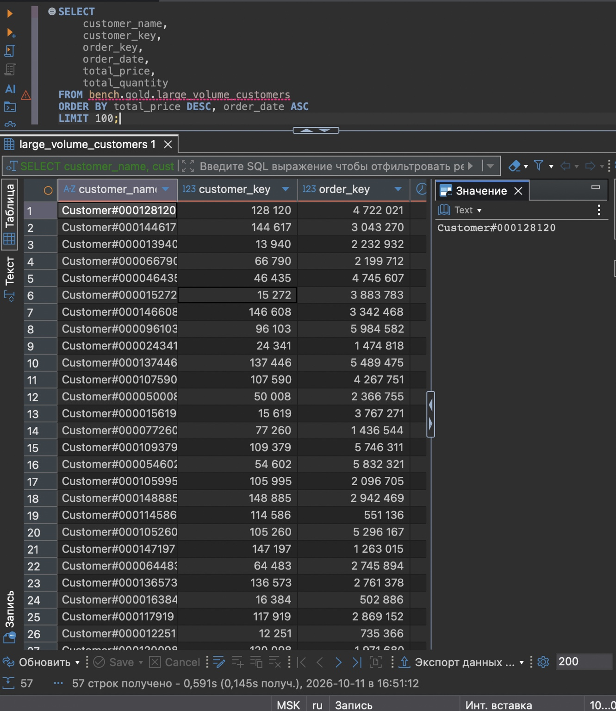
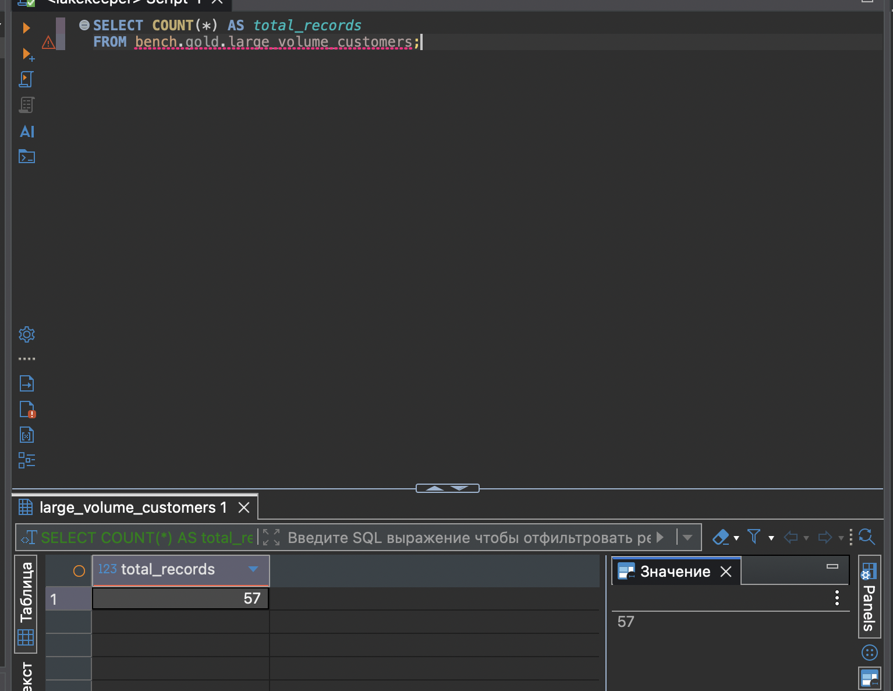
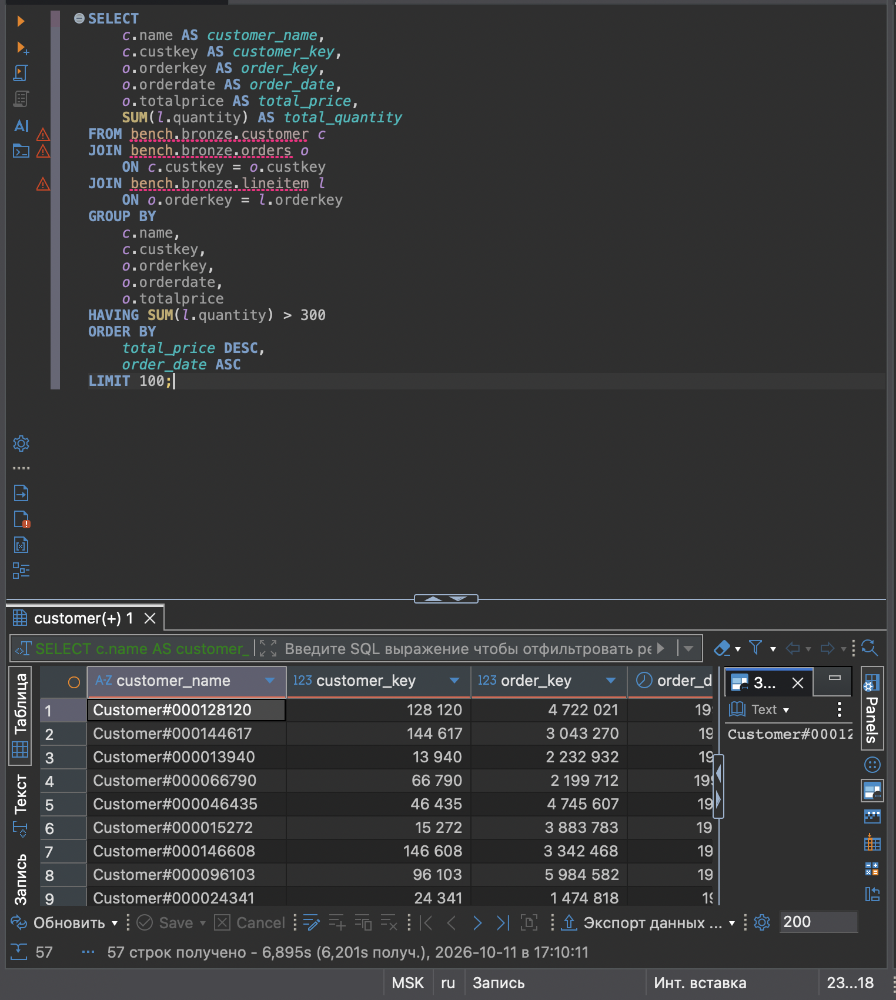
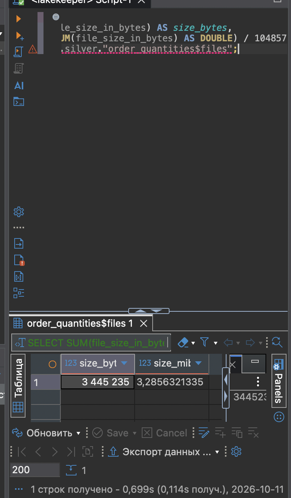
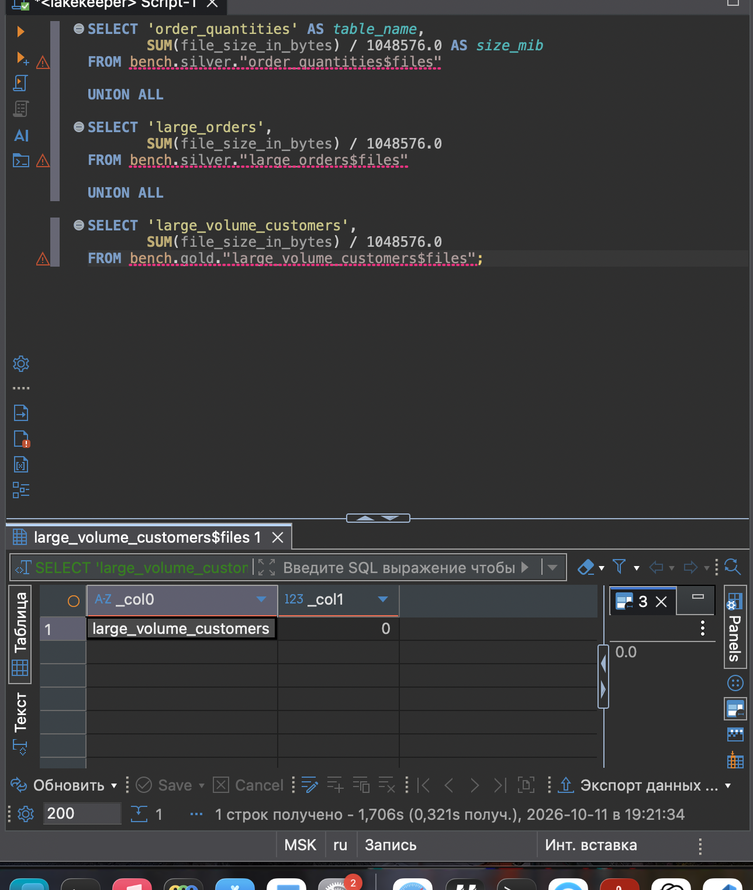
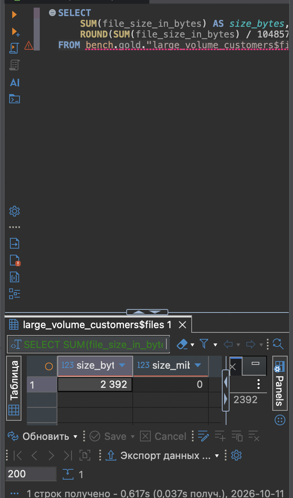
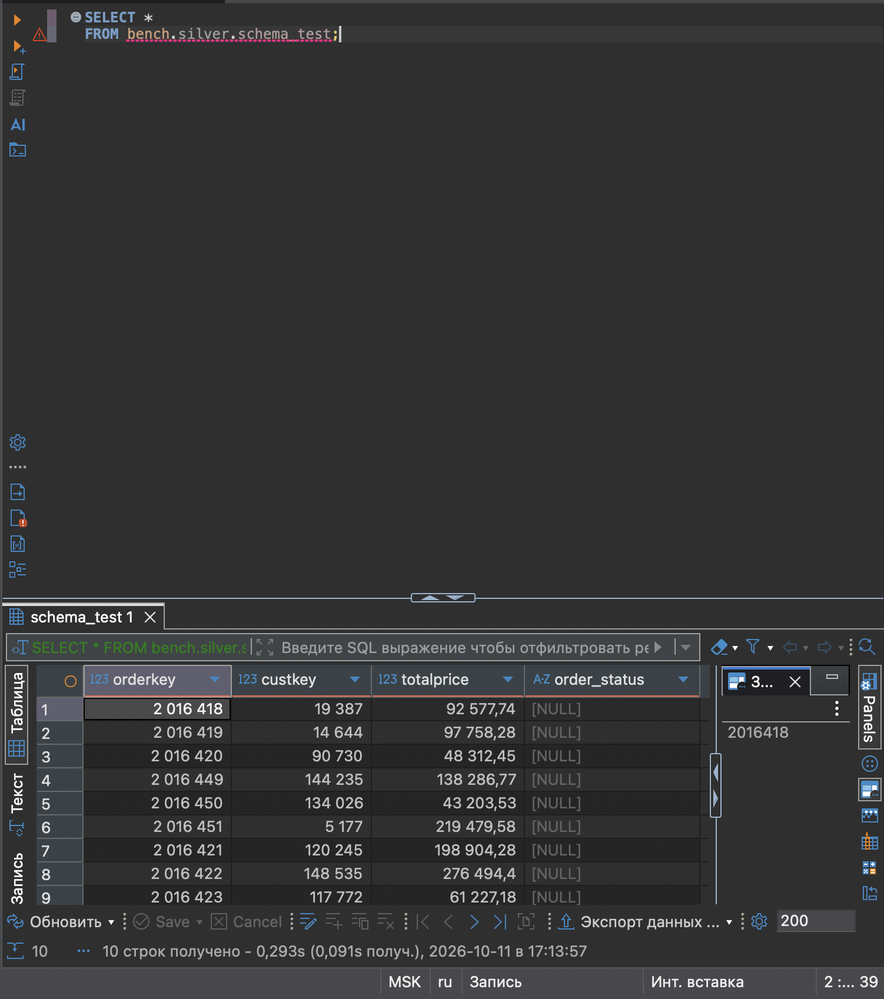
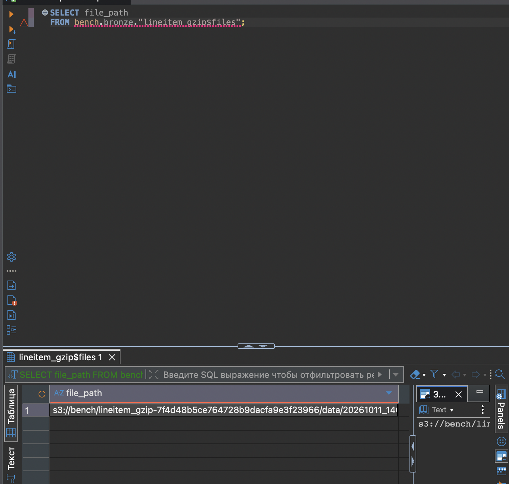
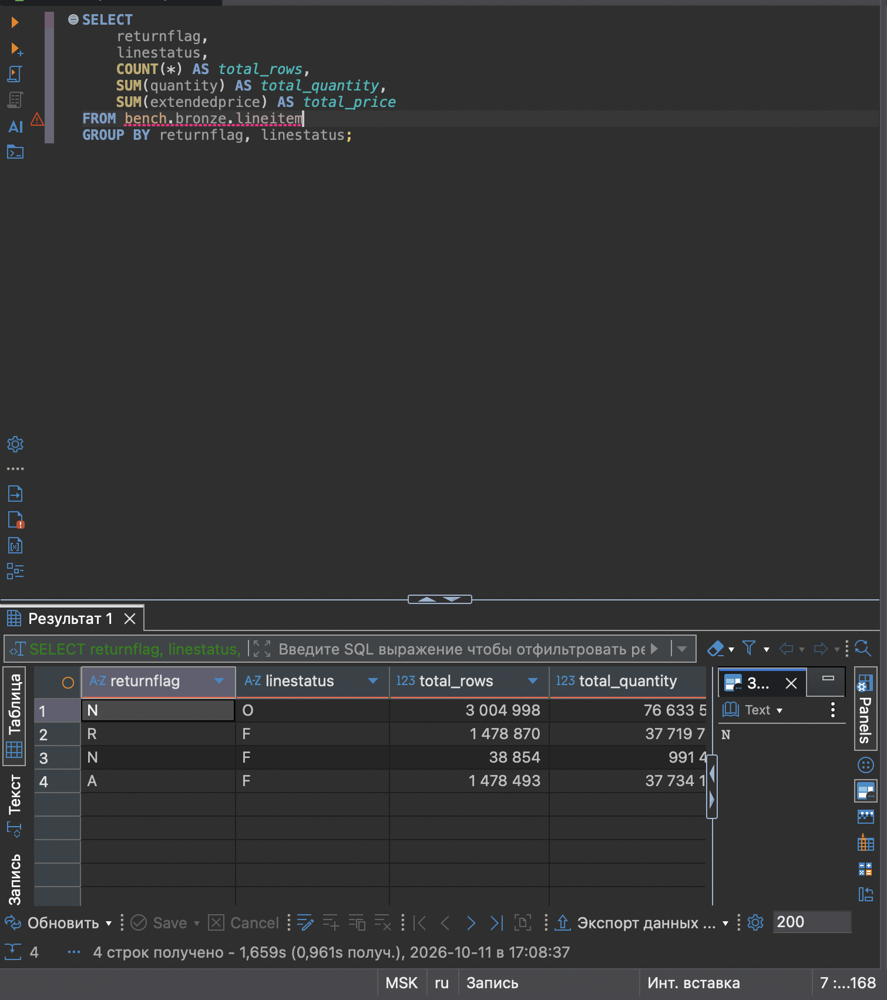

# Отчёт по практической №1 — вариант 3 (Q18 «Large Volume Customer»)
## 1. Вариант и масштаб

| Поле | Значение |
|---|---|
| ФИО (как в VK Education) | Александра Давидзон |
| Вариант (запрос) | 3 — Q18 «Large Volume Customer» |
| Масштаб `sfN` | sf1 |
| Почему выбрала такой масштаб | sf1 достаточно для проверки полного цикла ELT на локальном Mac: в `lineitem` примерно 6 млн строк. Этот масштаб позволяет получить воспроизводимые результаты без затрат ресурсов на sf10. |

## 2. Поднятые сервисы - и почему именно они
| Сервис | Версия | Роль в стеке | Почему именно он |
|---|---|---|---|
| MinIO | Docker-контейнер `lakehouse-minio` | S3-совместимое объектное хранилище, в котором физически находятся файлы Parquet и данные таблиц Iceberg. | Позволяет организовать локальное хранилище без использования платных облачных сервисов, например Amazon S3. Поддерживает S3 API, поэтому с ним могут работать Trino и Spark. |
| PostgreSQL | Версия 17, Docker-контейнер `lakehouse-pg` | Хранит служебную информацию, необходимую для работы Lakekeeper. | Бесплатная СУБД с открытым исходным кодом. Обеспечивает надёжное хранение служебных данных и подходит для локального развёртывания. |
| Lakekeeper | Docker-контейнер `lakekeeper` | REST-каталог Apache Iceberg, который управляет метаданными таблиц и обеспечивает доступ к ним. | Позволяет использовать единый каталог для нескольких вычислительных движков. Благодаря этому Trino и Spark могут обращаться к одним и тем же таблицам без копирования данных. |
| Trino | Версия 476, Docker-контейнер `trino` | Основной SQL-движок для создания таблиц, обработки данных и выполнения аналитических запросов. | Поддерживает Apache Iceberg и сложные SQL-запросы, включая JOIN, GROUP BY и агрегатные функции. Позволяет выполнять аналитические операции непосредственно над данными в объектном хранилище. |
| Apache Spark | Версия 3.5.5, отдельный Docker-контейнер | Дополнительный вычислительный движок для обработки и чтения данных Iceberg. | Подходит для пакетной обработки больших объёмов данных. Был выбран для проверки совместимости Lakehouse с несколькими движками. Успешно прочитал таблицу Bronze, содержащую 6 001 215 строк. |

## Обоснование выбранной архитектуры
Для выполнения практической работы была выбрана локальная архитектура Lakehouse на основе Apache Iceberg.

Данные хранятся в MinIO, а Lakekeeper управляет метаданными таблиц. PostgreSQL используется для хранения служебной информации каталога.
Trino применяется для выполнения SQL-запросов и построения слоёв Bronze, Silver и Gold.Apache Spark подключается к тому же каталогу и позволяет работать с уже созданными таблицами.

Преимущества выбранной архитектуры:

-  Данные хранятся отдельно от вычислительных движков.
- Trino и Spark могут работать с одними и теми же таблицами Apache Iceberg.
-  Все основные компоненты развёрнуты локально.
-  Основные компоненты доступны бесплатно и имеют открытый исходный код.
- Архитектура позволяет выполнять JOIN, агрегации и другие операции над большими наборами данных.

Контейнеры MinIO, PostgreSQL, Lakekeeper и Trino проверены командой:

```bash
docker ps -a --format "table {{.Names}}\t{{.Image}}\t{{.Status}}"
```
Во время проверки четыре контейнера были запущены, Trino имел статус `healthy`.

## Скрипты развёртывания

Использованная команда запуска Spark (из конфигурации работы):

```bash
docker run --rm -it \
  --name lakehouse-spark --network host \
  -v "$HOME/lakehouse/spark/conf:/opt/spark/conf" \
  -v "$HOME/lakehouse/spark/jars:/opt/spark/iceberg-jars" \
  -e AWS_ACCESS_KEY_ID=minioadmin \
  -e AWS_SECRET_ACCESS_KEY=minioadmin \
  -e AWS_REGION=us-east-1 \
  apache/spark:3.5.5 /opt/spark/bin/spark-sql \
  --master "local[2]" --driver-memory 1g
```

Использованы файлы `~/lakehouse/spark/conf/spark-defaults.conf` и два JAR-файла Iceberg 1.7.1. Каталог `bench` настроен через Lakekeeper REST, данные — через S3-совместимый MinIO.

####  Запуск MinIO

MinIO используется для хранения файлов данных Apache Iceberg в формате Parquet.

```bash
docker run -d \
  --name lakehouse-minio \
  -p 9000:9000 \
  -p 9001:9001 \
  -v minio-data:/data \
  -e MINIO_ROOT_USER="$MINIO_ROOT_USER" \
  -e MINIO_ROOT_PASSWORD="$MINIO_ROOT_PASSWORD" \
  quay.io/minio/minio:latest \
  server /data --console-address ":9001"
```
Использование Docker volume позволяет сохранять данные независимо от жизненного цикла контейнера.

#### Запуск PostgreSQL

PostgreSQL используется для хранения служебной информации Lakekeeper.

```bash
docker run -d \
  --name lakehouse-pg \
  -p 5432:5432 \
  -v pg-data:/var/lib/postgresql/data \
  -e POSTGRES_PASSWORD="$POSTGRES_PASSWORD" \
  postgres:17
```

PostgreSQL обеспечивает хранение служебного состояния каталога Lakekeeper.

#### Запуск Lakekeeper

Lakekeeper используется в качестве REST-каталога Apache Iceberg.

```bash
docker run -d \
  --name lakekeeper \
  -p 8181:8181 \
  -e LAKEKEEPER__PG_ENCRYPTION_KEY="$LAKEKEEPER_PG_ENCRYPTION_KEY" \
  -e LAKEKEEPER__PG_DATABASE_URL_READ="$LAKEKEEPER_PG_DATABASE_URL" \
  -e LAKEKEEPER__PG_DATABASE_URL_WRITE="$LAKEKEEPER_PG_DATABASE_URL" \
  quay.io/lakekeeper/catalog:latest-main \
  serve
```
Lakekeeper обеспечивает централизованное управление метаданными таблиц Apache Iceberg.

Благодаря использованию REST-каталога разные вычислительные движки могут работать с одними и теми же таблицами.

#### Запуск Trino

Trino используется в качестве основного SQL-движка.

```bash
docker run -d \
  --name trino \
  -p 8080:8080 \
  -v "$HOME/lakehouse/catalog:/etc/trino/catalog" \
  trinodb/trino:476
```

Trino использовался для:

- создания таблиц Bronze, Silver и Gold;
- загрузки и преобразования данных;
- выполнения аналитического запроса Q18;
- измерения времени выполнения SQL-запросов;
- проверки Schema Evolution и Time Travel.

## Проверка состояния контейнеров

Для проверки состояния сервисов использовалась команда:

```bash
docker ps
```

По результатам проверки все четыре основных контейнера находились в состоянии `running`.

| Контейнер | Образ | Порты | Состояние |
|---|---|---|---|
| `lakehouse-minio` | `quay.io/minio/minio:latest` | 9000, 9001 | Running |
| `lakehouse-pg` | `postgres:17` | 5432 | Running |
| `lakekeeper` | `quay.io/lakekeeper/catalog:latest-main` | 8181 | Running |
| `trino` | `trinodb/trino:476` | 8080 | Running, Healthy |

Все компоненты использовали стандартную сеть Docker `bridge`.


## 3. Разбор запроса — какие данные нужны

| Исходная таблица TPC-H | Используемые колонки | Для чего нужны |
|---|---|---|
| `customer` | `custkey`, `name` | Связь клиента с заказами и вывод имени клиента. |
| `orders` | `orderkey`, `custkey`, `orderdate`, `totalprice` | Связи между таблицами, дата и цена заказа, сортировка. |
| `lineitem` | `orderkey`, `quantity` | Группировка по заказу, сумма количества, условие `> 300`. |

**Запрос Q18 к данным Bronze**

```sql
SELECT
    c.name AS customer_name,
    c.custkey AS customer_key,
    o.orderkey AS order_key,
    o.orderdate AS order_date,
    o.totalprice AS total_price,
    SUM(l.quantity) AS total_quantity
FROM bench.bronze.customer c
JOIN bench.bronze.orders o ON c.custkey = o.custkey
JOIN bench.bronze.lineitem l ON o.orderkey = l.orderkey
GROUP BY c.name, c.custkey, o.orderkey, o.orderdate, o.totalprice
HAVING SUM(l.quantity) > 300
ORDER BY total_price DESC, order_date ASC
LIMIT 100;
```

Аналитический запрос Q18 (Large Volume Customer) предназначен для поиска заказов, суммарное количество товаров в которых превышает заданный порог. В данной работе используется порог 300 единиц товара.

## Результат выполнения запроса

При выполнении аналитического запроса Q18 над таблицами Bronze получено 57 строк.При использовании таблицы `bench.bronze.lineitem_gzip` вместо `bench.bronze.lineitem` также получено 57 строк.Это подтверждает, что оба варианта запроса возвращают одинаковое количество записей. Полученные данные используются для дальнейшего построения слоёв Silver и Gold, а также сравнения производительности различных алгоритмов сжатия.



*Результат выполнения аналитического запроса Q18 в DBeaver.*


## 4. Медальон-решение по каждому слою

Для организации данных использовалась медальонная архитектура, состоящая из трёх слоёв:

- **Bronze** — хранение исходных данных TPC-H без изменения их структуры.
- **Silver** — обработка, агрегация и фильтрация данных.
- **Gold** — итоговая аналитическая витрина для выполнения запроса Q18.

Все таблицы создавались в Apache Iceberg с использованием формата **PARQUET**. Основной алгоритм сжатия — **ZSTD**.

Parquet выбран для эффективного выполнения аналитических запросов, поскольку позволяет читать только необходимые столбцы. Apache Iceberg обеспечивает управление метаданными, поддержку изменения схемы (Schema Evolution) и доступ к предыдущим версиям данных (Time Travel).

В работе использовался масштаб **TPC-H sf1**. Партиционирование не применялось, поскольку для данного объёма данных оно не давало очевидных преимуществ и могло привести к появлению большого количества небольших файлов.

## Схема обработки данных
```text
TPC-H sf1
   |
Bronze: customer, orders, lineitem
   |
Silver: order_quantities → large_orders
   |
Gold: large_volume_customers
   |
Результат Q18: 57 строк
```
Исходные данные сохраняются в Bronze, затем в Silver рассчитывается суммарное количество товаров по каждому заказу и отбираются заказы с количеством более 300 единиц. В Gold формируется итоговая таблица с информацией о клиентах и крупных заказах.

## Bronze 

Слой Bronze предназначен для хранения исходных таблиц TPC-H.

| Таблица | Колонки | Строк | Вес, МБ | Формат | Сжатие | Партиционирование | Обоснование |
|---|---|---:|---:|---|---|---|---|
| `bench.bronze.customer` | Все столбцы `tpch.sf1.customer` | 150 000 | 8,20 | PARQUET | ZSTD* | Нет | Parquet удобен для чтения отдельных полей клиентов, ZSTD уменьшает объём хранения. При 150 тыс. строк партиционирование не требуется. |
| `bench.bronze.orders` | Все столбцы `tpch.sf1.orders` | 1 500 000 | 36,66 | PARQUET | ZSTD* | Нет | Parquet эффективен для аналитических запросов по заказам, ZSTD сокращает размер файлов. Для масштаба sf1 дополнительное партиционирование нецелесообразно. |
| `bench.bronze.lineitem` | Все столбцы `tpch.sf1.lineitem` | 6 001 215 | 151,93 | PARQUET | ZSTD | Нет | Parquet подходит для агрегации `quantity` и соединения по `orderkey`, ZSTD обеспечивает сжатие. Партиционирование не применялось, поскольку Q18 обрабатывает всю таблицу. |

**Пример создания таблицы Bronze**

```sql
CREATE TABLE bench.bronze.lineitem
WITH (format = 'PARQUET') AS
SELECT *
FROM tpch.sf1.lineitem;
```
## Silver 

Слой Silver используется для предварительной обработки данных.

В нём созданы две таблицы:

- `order_quantities` — суммарное количество товаров для каждого заказа.
- `large_orders` — заказы, в которых суммарное количество товаров превышает 300.

| Таблица | Колонки | Строк | Вес, МБ | Формат | Сжатие | Партиционирование | Обоснование |
|---|---|---:|---:|---|---|---|---|
| `bench.silver.order_quantities` | `orderkey`, `total_quantity` | 1 500 000 | 3,44524 | PARQUET | ZSTD | Нет | Parquet эффективен для хранения агрегированных данных, ZSTD уменьшает объём файлов. Партиционирование не требуется, поскольку таблица содержит только два столбца и имеет небольшой размер. |
| `bench.silver.large_orders` | `orderkey`, `total_quantity` | 57 | 0,00079 | PARQUET | ZSTD* | Нет | Parquet и ZSTD сохраняют единый формат хранения. Из-за небольшого количества строк партиционирование нецелесообразно. |

**Агрегация количества товаров по заказам**

```sql
SELECT
    orderkey,
    SUM(quantity) AS total_quantity
FROM bench.bronze.lineitem
GROUP BY orderkey;
```
В результате получено 1 500 000 строк.
**Отбор крупных заказов**
```sql
SELECT
    orderkey,
    total_quantity
FROM bench.silver.order_quantities
WHERE total_quantity > 300;
```

В результате отобрано 57 заказов.



* Результат проверки количества отобранных заказов.*


Проверка показала, что минимальное значение `total_quantity` составляет 301, а максимальное — 328. Все 57 заказов соответствуют условию Q18.

## Gold 

Слой Gold содержит итоговые данные, подготовленные для аналитического запроса Q18.
| Таблица | Колонки | Строк | Вес, МБ | Формат | Сжатие | Партиционирование | Обоснование |
|---|---|---:|---:|---|---|---|---|
| `bench.gold.large_volume_customers` | `customer_name`, `customer_key`, `order_key`, `order_date`, `total_price`, `total_quantity` | 57 | 0,002392 | PARQUET | ZSTD* | Нет | Parquet обеспечивает единый формат хранения с остальными слоями, ZSTD используется для сжатия. Из-за небольшого объёма данных партиционирование не требуется. |

Gold формируется путём соединения таблицы `bench.silver.large_orders` с таблицами `bench.bronze.orders` и `bench.bronze.customer`.

**SQL-логика формирования итоговой витрины**

```sql
SELECT
    c.name AS customer_name,
    c.custkey AS customer_key,
    o.orderkey AS order_key,
    o.orderdate AS order_date,
    o.totalprice AS total_price,
    lo.total_quantity
FROM bench.silver.large_orders lo
JOIN bench.bronze.orders o
    ON lo.orderkey = o.orderkey
JOIN bench.bronze.customer c
    ON o.custkey = c.custkey;
```

В результате получена таблица `bench.gold.large_volume_customers`, содержащая 57 строк.



* Результат аналитической выборки для итоговой витрины.*


## Проверка количества строк и размеров таблиц

Количество строк определялось с помощью SQL-запроса:
```sql
SELECT COUNT(*)
FROM bench.bronze.lineitem;
```
Размеры таблиц определялись по метаданным файлов Apache Iceberg:
```sql
SELECT
    SUM(file_size_in_bytes) AS size_bytes,
    CAST(SUM(file_size_in_bytes) AS DOUBLE) / 1000000 AS size_mb
FROM bench.bronze."lineitem$files";
```
Аналогичные запросы выполнялись для остальных таблиц Bronze, Silver и Gold.



* Проверка размера итоговой таблицы Gold по метаданным Iceberg.*




*Проверка размера таблицы large_orders по метаданным Iceberg.*




* Проверка размера таблицы order_quantities по метаданным Iceberg.*


## Вывод

В результате была построена медальонная архитектура Bronze → Silver → Gold.В Bronze сохранены исходные данные TPC-H `sf1`, включая таблицу `lineitem` с **6 001 215 строками**.В Silver рассчитано суммарное количество товаров для **1 500 000 заказов** и выделено **57 заказов**, удовлетворяющих условию `total_quantity > 300`.В Gold сформирована итоговая аналитическая витрина `large_volume_customers`, содержащая **57 записей**.Для всех слоёв выбран формат Parquet со сжатием ZSTD. Партиционирование не применялось, поскольку на используемом масштабе данных оно не было необходимо для выполнения Q18.

## 5. Тесты производительности
## Результаты сравнения

| Показатель | ZSTD | GZIP |
|---|---:|---:|
| Таблица | `lineitem` | `lineitem_gzip` |
| Количество строк | 6 001 215 | 6 001 215 |
| Размер `lineitem`, МБ | **151,93** | **148,27** |
| Q18, первый запуск | **6,895 с** | **6,078 с** |
| Q18, повторный запуск | **5,513 с** | **5,269 с** |
| Количество строк результата | 57 | 57 |

## Анализ результатов

В проведённом эксперименте таблица со сжатием GZIP занимала меньше места, чем таблица со сжатием ZSTD.

Разница составила приблизительно 3,66 МБ, или 2,4% относительно размера ZSTD.

По времени выполнения запроса Q18 GZIP также показал немного лучшие результаты:

- Первый запуск GZIP — 6,078 с, ZSTD — 6,895 с.
- Повторный запуск GZIP — 5,269 с, ZSTD — 5,513 с.
## Вывод
В рамках проведённого эксперимента GZIP показал немного меньший размер файлов и более низкое время выполнения Q18, чем ZSTD.При этом разница в производительности была небольшой, а количество измерений ограниченным.Оба алгоритма подходят для хранения аналитических данных в формате Parquet. Полученные результаты характеризуют конкретный эксперимент на локальной инфраструктуре Lakehouse с масштабом TPC-H `sf1`.

## 6. Часть 2 — осмысление и работа с инструментами

## Зачем нужны большие данные и Lakehouse, а не только обычная база данных?
Обычные реляционные базы данных хорошо подходят для хранения структурированных данных и выполнения транзакционных операций. Однако при обработке больших аналитических наборов данных может потребоваться более гибкая архитектура.
Lakehouse предоставляет следующие преимущества:

- Масштабируемое хранение. Объектное хранилище MinIO позволяет хранить большие объёмы данных отдельно от вычислительных ресурсов.
- Поддержка аналитических форматов. Parquet обеспечивает эффективное чтение отдельных столбцов, что полезно при аналитических запросах.
- Работа с несколькими движками. Одни и те же таблицы Iceberg могут использоваться разными инструментами, например Trino и Apache Spark.
- Schema Evolution. Возможность изменять структуру таблиц без пересоздания и потери существующих данных.
- Time Travel.Возможность обращаться к предыдущим версиям таблиц.

Таким образом, Lakehouse особенно полезен для аналитических задач, где требуется хранить и обрабатывать большие наборы данных с помощью разных инструментов.

При этом обычные реляционные базы данных остаются подходящим решением для транзакционных систем.

### Демонстрация Schema Evolution

**Schema Evolution** — возможность изменять структуру таблицы без её полного пересоздания.Для демонстрации была создана отдельная тестовая таблица `bench.silver.schema_test` в слое Silver.Сначала в неё были загружены 10 строк из таблицы `bench.bronze.orders`.

**Создание тестовой таблицы:**

```sql
CREATE TABLE bench.silver.schema_test
WITH (format = 'PARQUET') AS
SELECT
    orderkey,
    custkey,
    totalprice
FROM bench.bronze.orders
LIMIT 10;
```
Первоначально таблица содержала три столбца
- `orderkey` — номер заказа;
- `custkey` — номер клиента;
- `totalprice` — стоимость заказа.
Затем с помощью `ALTER TABLE` был добавлен новый столбец `order_status`.
**Добавление столбца:**
```sql
ALTER TABLE bench.silver.schema_test
ADD COLUMN order_status VARCHAR;
```
**Проверка результата:**
```sql
SELECT *
FROM bench.silver.schema_test;
```
После выполнения команды:
- количество строк осталось прежним — 10;
- количество столбцов увеличилось с 3 до 4;
- в существующих строках значение нового столбца `order_status` стало `NULL`.



* Результат просмотра таблицы после изменения схемы.*

Результат: Apache Iceberg позволил изменить схему таблицы без удаления или повторной загрузки существующих данных.
Это полезно, когда в процессе работы появляются новые требования к структуре данных, например необходимость хранить дополнительную информацию о заказах.

### Демонстрация Time Travel

**Time Travel** — возможность читать предыдущие версии таблицы, сохранённые в Apache Iceberg.Для проверки использовалась та же тестовая таблица `bench.silver.schema_test`.После выполнения Schema Evolution в таблице находилось 10 строк.Затем была добавлена ещё одна запись.
**Добавление новой записи**
```sql
INSERT INTO bench.silver.schema_test
    (orderkey, custkey, totalprice, order_status)
VALUES
    (9999999, 12345, 50000.00, 'NEW');
```
**Проверка текущего количества строк:**
```sql
SELECT COUNT(*)
FROM bench.silver.schema_test;
```
Результат:

```text
11
```
После этого были просмотрены сохранённые снимки состояния таблицы.



*Просмотр метаданных снапшотов Iceberg.*

**Просмотр снапшота:**
```sql
SELECT
    snapshot_id,
    committed_at,
    operation
FROM bench.silver."schema_test$snapshots"
ORDER BY committed_at;
```
Для обращения к предыдущей версии использовался Snapshot ID:
`4445760892284850749`
**Чтение предыдущей версии таблицы:**
```sql
SELECT COUNT(*)
FROM bench.silver.schema_test
FOR VERSION AS OF 4445760892284850749;
```
Результат:
```text
10
```
**Сравнение результатов**
| Состояние таблицы | Количество строк |
|---|---:|
| До добавления новой записи | 10 |
| После добавления новой записи | 11 |
| При чтении предыдущей версии через Time Travel | 10 |



* Проверка предыдущей версии таблицы с помощью Iceberg.*


**Результат** Apache Iceberg позволил прочитать предыдущую версию таблицы, в которой находилось 10 строк, несмотря на то что в текущей версии уже было 11 строк.Важно отметить, что команда `FOR VERSION AS OF` не откатывает таблицу физически, а только позволяет прочитать её состояние на момент выбранного снимка.
Эта возможность полезна для проверки изменений, анализа предыдущих состояний данных и восстановления информации из доступных исторических версий.

###  Подключение второго движка — Apache Spark
В основной части практической работы для выполнения SQL-запросов использовался **Trino**.В качестве второго инструмента был выбран **Apache Spark 3.5.5**, запущенный в Docker.

**Почему  Apache Spark**
- Spark предназначен для распределённой обработки больших объёмов данных.
- Поддерживает пакетную обработку и выполнение SQL-запросов.
- Может работать с таблицами Apache Iceberg.
- Позволяет использовать те же данные, что и Trino, без создания отдельной копии.
Для подключения Spark использовался Iceberg REST Catalog, предоставляемый Lakekeeper. Данные таблиц находились в объектном хранилище MinIO.

Таким образом, Trino и Spark обращались к одному каталогу Iceberg и работали с общими таблицами.
#### Проверка подключения к каталогу
После запуска Spark SQL была выполнена команда:

```sql
SHOW NAMESPACES IN bench;
```
Результат:
```text
lakehouse
gold
silver
bronze
```
Spark успешно обнаружил пространства имён каталога `bench`, включая все три слоя медальонной архитектуры.
#### Проверка чтения данных Bronze
Для подтверждения доступа к данным был выполнен запрос:
```sql
SELECT COUNT(*) AS total_rows
FROM bench.bronze.lineitem;
```
Результат:
```text
6001215
```
Время выполнения:
```text
Time taken: 3.41 seconds
```
Полученное количество строк совпало с результатом, ранее полученным через Trino.
| Показатель | Результат |
|---|---|
| Второй вычислительный движок | Apache Spark 3.5.5 |
| Способ запуска | Docker |
| Формат таблиц | Apache Iceberg |
| Каталог | Lakekeeper REST Catalog |
| Хранилище | MinIO |
| Проверяемая таблица | `bench.bronze.lineitem` |
| Количество строк | 6 001 215 |
| Время выполнения запроса | 3,41 с |
| Результат подключения | Успешно |

###  Общий вывод
**Schema Evolution** позволил добавить новый столбец в таблицу Silver без потери существующих данных.
**Time Travel** позволил прочитать предыдущую версию таблицы, содержащую 10 строк, после добавления новой записи в текущую версию.
**Apache Spark** был успешно подключён как второй вычислительный движок. Он обнаружил пространства имён Iceberg и прочитал таблицу Bronze с 6 001 215 строками.

## 7. Выводы

В ходе практической работы была построена локальная Lakehouse-инфраструктура на основе MinIO, PostgreSQL, Lakekeeper, Apache Iceberg и Trino.Для выполнения аналитического запроса Q18 использовался масштаб TPC-H sf1. Данные были организованы по медальонной архитектуре Bronze → Silver → Gold. В Bronze сохранены исходные таблицы customer, orders и lineitem. В Silver выполнена агрегация количества товаров по заказам и отобраны 57 заказов, удовлетворяющих условию total_quantity > 300. В Gold создана итоговая аналитическая витрина с информацией о клиентах и крупных заказах.Для хранения данных использовался формат Parquet со сжатием ZSTD.Дополнительно проведено сравнение алгоритмов GZIP и ZSTD на таблице lineitem. В данном эксперименте GZIP показал немного меньший размер файлов и более низкое время выполнения запроса Q18.Также были проверены возможности Apache Iceberg:Schema Evolution и Time Travel. Эксперименты подтвердили возможность изменения структуры таблицы и чтения её предыдущих версий.В качестве второго вычислительного движка был подключён Apache Spark 3.5.5. Он успешно прочитал таблицу Bronze,содержащую 6 001 215 строк, через общий каталог Iceberg.Таким образом, практическая работа позволила изучить принципы построения Lakehouse, организацию данных по слоям Bronze, Silver и Gold, сравнение алгоритмов сжатия и совместную работу нескольких вычислительных движков.
